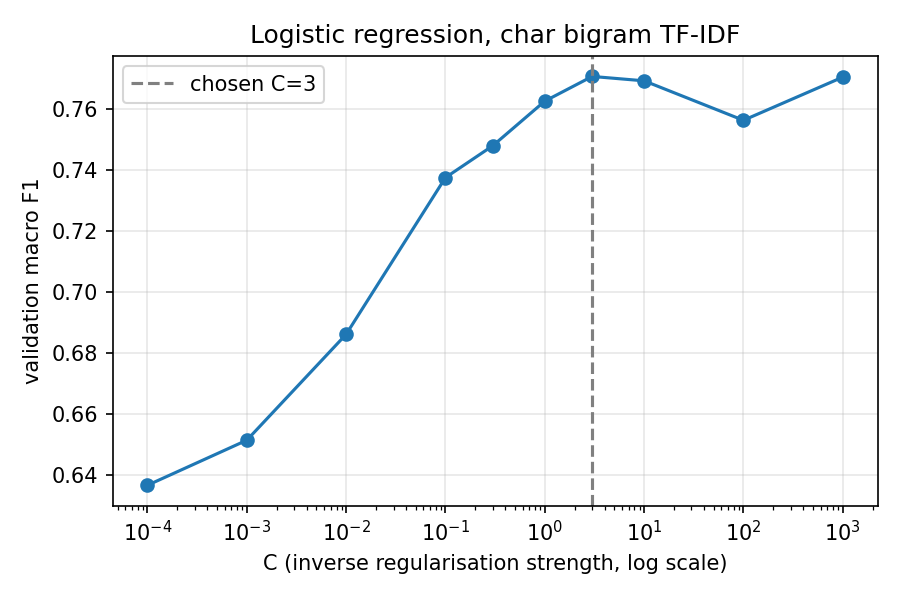
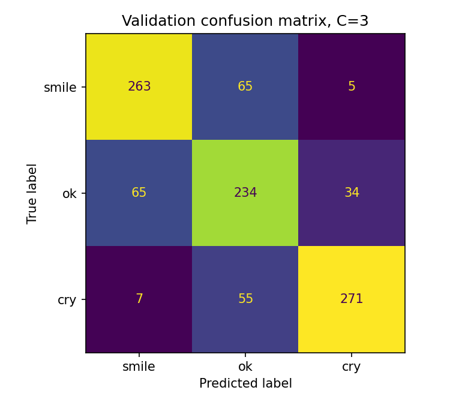

## 2. Theoretical Justification

### 2.1 Choice of model family

Our baseline is logistic regression on TF-IDF character bigrams. The paper only compared transformers with each other, so there is nothing in it that shows how much of the SA macro F1 is the BERT architecture and how much is just reading the text. Logistic regression is the floor for "anything that reads the text", above the majority baseline that reads nothing. If BERT cannot beat it, the problem is in the fine-tuning, not the data.

### 2.2 Loss function and optimiser

Cross-entropy is the loss function -log of the probability given to the true class, plus an L2 penalty set by C. For the optimizer we used scikit-learn's default solver, L-BFGS, with max_iter=1000.

### 2.3 Bias-variance trade-off

A very small C squashes every weight toward zero and the model underfits (high bias) at C=0.0001 validation macro F1 is 0.6368, climbing to 0.7705 at C=3. A large C lets rare bigrams get big weights, which is overfitting (variance), train macro F1 at C=3 is 0.9935 against 0.7705 on validation. Loosening C past 3 does not make validation worse in any consistent way, since those rare bigrams appear in very few of the 999 validation reviews; from C=3 to 1000 the score wobbles between 0.7562 and 0.7705 (Figure 1). We chose C=3, the best score and the smallest C in the flat region.

### 2.4 Evaluation methodology

We are using macro F1, the average of the per-class F1 scores, because it is a way we can directly compare our results with the paper. Accuracy alone would hide a model that doesn't do well per class, for the majority class baseline the accuracy is 0.33 while the macro F1 is 0.1667, that is (0.5 + 0.0 + 0.0) / 3. Numbers are sourced from `f1_score(average="macro")` in lr_baseline.py and naive_baseline.py, plus the classification_report for per-class scores. C was chosen on validation (999 reviews); test (999 reviews) is untouched and will be run once at the end with the final model.

### 2.5 Alternatives considered

- **Word segmentation (jieba).** jieba is trained on Mandarin, so its word boundaries break on Cantonese slang and particles. Character bigrams need no segmenter.
- **Other classifiers on the same features (KNN, decision trees).** We considered KNN, but with 316,670 features every review is far from every other review, so distance carries little signal, and each prediction has to compare against all 9,999 training rows. We could have tried decision trees, but a tree splits on a single bigram at a time, so it would need very deep trees to combine evidence from hundreds of bigrams. Logistic regression sums evidence from every bigram in one step and C gives one knob to tune.
- **Other n-gram sizes.** Cantonese words are mostly one or two characters, so bigrams capture most words. Unigrams lose negation (差 vs 唔差); trigrams would blow up the column count.

## 3. Preliminary Results

### 3.1 Results table

| Model | Features | Split | Train macro F1 | Valid/Test macro F1 | Fit time |
|-------|----------|-------|----------------|---------------------|----------|
| Majority class | none | validation | 0.1667 | 0.1667 | 0 s |
| Logistic regression | char bigram TF-IDF (316,670 columns), C=3 | validation | 0.9935 | 0.7705 | 9.3 s (CPU) |
| hon9kon9ize/bert-base-cantonese (paper) | fine-tuned end to end | test | not reported | 0.719 | not reported |

Run from `data/sentiment`: `python naive_baseline.py`, `python lr_baseline.py`, `python plot_lr.py` (train F1, fit time, figures).

### 3.2 Visualisations



Figure 1. Validation macro F1 vs C (log x-axis). Dashed line is the chosen C=3.



Figure 2. Validation confusion matrix at C=3.

### 3.3 Key findings

Majority scores 0.1667 because it predicts one class and gets F1 of 0 on the other two. LR at 0.7705 on the same split means char bigrams carry real sentiment signal with no word order at all.

The ok class had the smallest F1 score, 0.68. The most common pair was ok misclassified as smile and vice versa. 219 of the 231 misses involve ok on one side, only 12 are smile/cry swaps, which means the model separates the extremes well and the middle is where most of the misclassification is.

### 3.4 Error analysis

Out of the 999 validation reviews the tuned model got 231 wrong. The misses per true class are 70 smile, 99 ok and 62 cry, so ok is the class most often misclassified.

```
label smile ->  predicted label ok: 65
label ok ->  predicted label smile: 65
label cry ->  predicted label ok: 55
label ok ->  predicted label cry: 34
label cry ->  predicted label smile: 7
label smile ->  predicted label cry: 5
```

Counts come from the `wrong` list and Counter at the bottom of `lr_baseline.py`.

Hypotheses to check when BERT runs (M5):

1. Noisy ok labels. Mixed reviews tagged ok confuse any model. If BERT's ok F1 stays near 0.68, the labels are the ceiling, not the architecture.
2. Dilution. The verdict in the title is outvoted by the body. BERT reads in order and could weight the opening. Check: do the 12 swaps flip.
3. Negation. 唔 inside positive phrases like 唔差 fools a bigram counter. Check: same 12.
4. Truncation. BERT sees only 512, LR saw everything. Check: do BERT's misses cluster in the 12% of reviews over 512.

### 3.5 Limitations

Our macro F1 of 0.7705 is on validation; the paper's 0.719 is on test. Although our tuned logistic regression looks better than the paper's BERT, we cannot conclude that a simple model outperforms the BERT architecture. We used the validation split while they used test, and we ran many C values and kept the best one for this split. Once the tuned model is run on the test split, once, the two numbers become comparable. The train/validation gap (0.99 vs 0.77) also shows the model memorises the training set.
